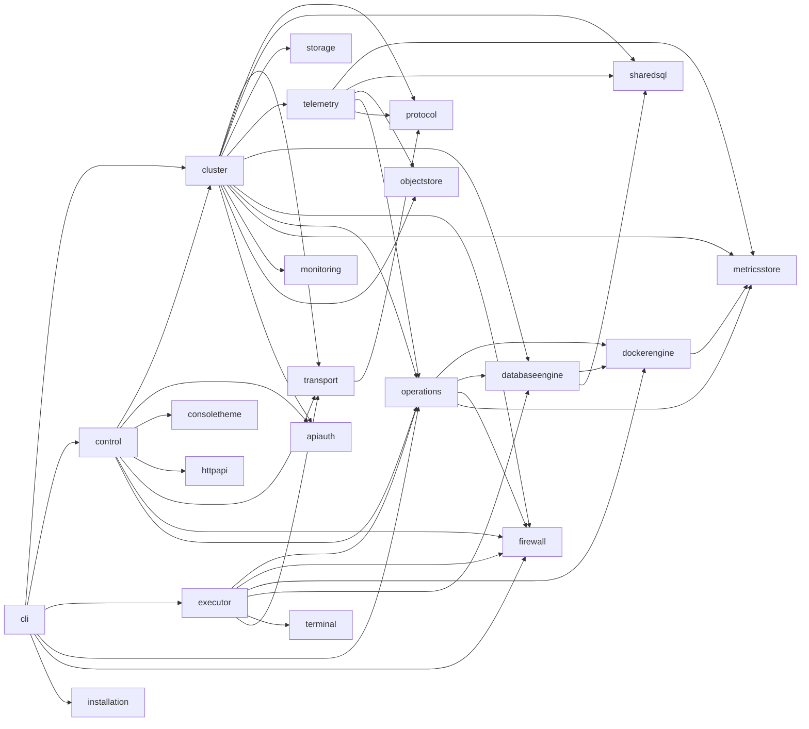
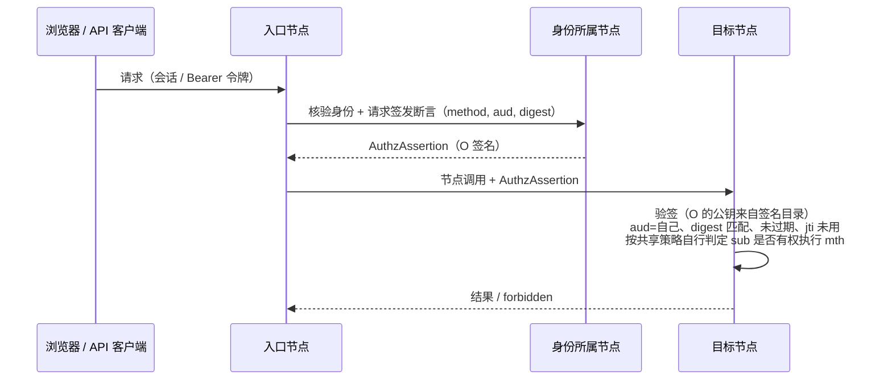
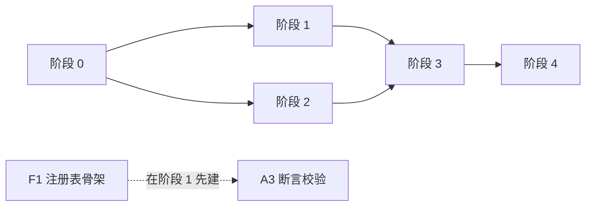

# OPSD 架构审查与改进方案

| 项目 | 内容 |
|---|---|
| 审查对象 | `F:\Code\1server\opsd`（版本 `0.1.0-dev`，Go 模块 `github.com/jkfujr/opsd`） |
| 审查日期 | 2026-11-23 |
| 审查范围 | 后端架构、安全边界、数据权威、依赖结构、节点协议、前端产物、文档与 CI |
| 主要依据 | `docs/ARCHITECTURE.md`、`AGENTS.md`、`.data/全面架构设计/00-架构设计总纲.md`、`.github/workflows/ci.yml`、`backend/` 全部非测试 Go 源码的导入与规模统计、关键文件抽查 |
| 文档性质 | 审查结论 + 设计方案。方案中的接口、表结构与命名均为建议稿，落地前需按 `docs/VALIDATION.md` 的流程验收 |

---

## 目录

1. [结论摘要](#1-结论摘要)
2. [现状架构](#2-现状架构)
3. [做得好的地方](#3-做得好的地方)
4. [问题清单](#4-问题清单)
5. [改进方案](#5-改进方案)
   - [方案 A：安全边界重建](#方案-a安全边界重建)
   - [方案 B：设计文档治理](#方案-b设计文档治理)
   - [方案 C：共享存储拓扑与自举恢复](#方案-c共享存储拓扑与自举恢复)
   - [方案 D：共享数据单一权威来源](#方案-d共享数据单一权威来源)
   - [方案 E：cluster 包拆分](#方案-ecluster-包拆分)
   - [方案 F：节点调用类型化](#方案-f节点调用类型化)
   - [方案 G：依赖方向治理与架构测试](#方案-g依赖方向治理与架构测试)
   - [方案 H：CI 质量门](#方案-hci-质量门)
   - [方案 I：前端与嵌入产物瘦身](#方案-i前端与嵌入产物瘦身)
   - [方案 J：遗留清理](#方案-j遗留清理)
6. [实施路线图](#6-实施路线图)
7. [兼容性与风险](#7-兼容性与风险)
8. [附录](#8-附录)

---

## 1. 结论摘要

OPSD 的**执行语义设计是这个项目最强的部分**：持久受理、幂等键与参数摘要绑定、应答未知时只查询原 ID 不重放、每个操作一个 systemd 单元并可恢复、全程有界资源预算。这些设计成熟度高，应作为后续所有改造的不变量保留。

主要风险集中在三处：

1. **信任边界形同虚设。** root 执行器只靠 Socket 文件权限保护，且对终端连接不做任何校验；节点之间按"成员即完全受信"处理，目标节点信任入口节点断言的调用身份。结果是：**任一节点的普通用户进程被攻破 ≈ 全集群所有节点的 root**。
2. **设计依据失控。** `AGENTS.md` 指定的权威总纲位于被 `.gitignore` 忽略的 `.data/`，且总纲（2026-10-30）与当前实现在存储选型、数据库部署、防火墙管理等核心决策上已经相反，只有 1 篇 ADR。
3. **核心包复杂度过高。** `cluster` 包占全部业务代码的 38%，`Node` 结构体 50+ 字段、11 把锁、287 个方法，节点间调用靠字符串分派，CI 不跑 `-race`/`vet`/静态检查。

改进按风险排序分五个阶段推进（详见第 6 节）：先用低成本手段把 root 边界补上并把设计文档纳入版本管理（阶段 0），再做目标侧授权（阶段 1），然后约束共享存储拓扑、下线 CouchDB（阶段 2），最后做 `cluster` 拆分与节点调用类型化（阶段 3）以及产物瘦身（阶段 4）。

### 问题总表

| ID | 严重度 | 问题 | 对应方案 |
|---|---|---|---|
| SEC-1 | **P0** | root 执行器只靠 Socket 文件权限，不校验调用方，终端入口无任何校验 | A1、A2 |
| SEC-2 | **P0** | 节点间信任传递：远端终端与业务调用只校验"对方是有效成员"，调用身份由入口断言 | A3、A4 |
| DOC-1 | **P0** | 权威总纲与 `AGENTS.md` 未纳入版本管理，且与实现冲突；ADR 缺失 | B |
| DATA-1 | P1 | 共享存储形成自举循环；Galera 拓扑未约束，跨地域与分区行为未定义 | C |
| DATA-2 | P1 | 共享真相同时存在三份（签名目录 / Galera / CouchDB），同一数据两套路径 | D |
| ARCH-1 | P1 | `cluster` 包职责过载，锁顺序无文档，`control` 直接依赖 `*cluster.Node` | E |
| ARCH-2 | P1 | 节点间调用按字符串分派、参数为原始 JSON，能力协商只有标量版本号 | F |
| ARCH-3 | P2 | 依赖方向不当：`dockerengine→metricsstore`；`operations` 把 root 实现链接进普通进程 | G |
| QA-1 | P2 | CI 无 `-race`、`go vet`、静态检查与漏洞扫描；约 75 处显式忽略返回值 | H |
| FE-1 | P2 | 8 套前端并存，6 套类型已过期；嵌入资源 28 MB（中文字体约 25 MB） | I |
| CLN-1 | P3 | 旧 Hub/Agent 架构残留空目录 | J |

---

## 2. 现状架构

### 2.1 进程与边界

```
opsd（单一程序，入口：version / install / node / network / data / executor / operation / recover / console）
│
├─ opsd node（普通用户）
│   ├─ transport   Noise IK（25519 / ChaChaPoly / SHA256，Prologue "OPSD/node/v2"）over WebSocket
│   ├─ cluster     成员目录、节点调用分派、本机队列、共享流程、数据库管理、防火墙策略、当前读取……
│   ├─ control     HTTP /api/v2、浏览器会话、SSE、终端票据、主题（直接持有 *cluster.Node）
│   └─ telemetry   监控采集 / 上传 / 接收（facade + adapter，不导入 cluster）
│
├─ opsd executor（root）
│   ├─ Unix Socket（0660，root:<opsd 组>），HTTP 路由：POST /rpc、POST /storage、GET /terminal
│   └─ operations / firewall / dockerengine / databaseengine / terminal
│
└─ opsd-operation@<id>.service / opsd-recover.service（root，按操作隔离的 systemd 单元）
```

### 2.2 包规模（非测试、非生成代码）

| 包 | 文件 | 业务行数 | 测试行数 | 生成行数 | 内部依赖数 |
|---|---:|---:|---:|---:|---:|
| `cluster` | 54 | 15,803 | 4,918 | 4 | 16 |
| `firewall` | 18 | 5,299 | 1,613 | – | 2 |
| `control` | 27 | 4,235 | 3,689 | 4,658 | 15 |
| `protocol` | 22 | 2,553 | 159 | – | 0 |
| `databaseengine` | 13 | 2,469 | 374 | – | 3 |
| `operations` | 13 | 2,016 | 1,300 | – | 6 |
| `dockerengine` | 9 | 1,509 | 344 | – | 2 |
| `telemetry` | 5 | 1,284 | 146 | – | 6 |
| `executor` | 7 | 1,214 | 417 | – | 11 |
| 其余 20 个包 | – | 约 5,400 | 约 2,000 | 约 54,900 | – |
| **合计** | – | **约 42,000** | **约 15,000** | **约 60,000** | – |

### 2.3 内部依赖（节选）



### 2.4 状态存储一览

| 存储 | 位置 | 内容 |
|---|---|---|
| 节点 SQLite | 每节点 `node.db` | 身份、账号、会话、配置、成员目录、队列、请求回执、待上传记录、任务、主题 |
| 执行器 SQLite | 每节点 `executor.db` | root 操作意图 / 结果、防火墙确认配置、互信目标、资源声明 |
| 指标 SQLite | 每节点 `metrics.sqlite` | 秒级缓冲、上传回执、缺口记录 |
| 签名成员目录 | 节点间传播，落地于 `node.db` | 成员、地址、互信策略、未绑定阶段的数据库定义 |
| Galera `opsd_core` | 由 OPSD 部署，经每节点 ProxySQL 访问 | 成员权限、共享策略、数据库定义、跨节点流程、回执、签名历史 |
| CouchDB（迁移中） | 存储角色节点 | 旧历史与上传 |
| S3 + Thanos | 监控宿主 | 指标归档（原始 / 5 分钟 / 1 小时，365 天） |

---

## 3. 做得好的地方

这些是后续改造必须保留的不变量。

1. **操作生命周期严谨。** 受理、意图、读回、结果分步持久化；`enqueueTx` 用 `(origin, request_key)` 唯一约束，并比对 64 位十六进制 `InputDigest`，同键不同参数返回 `conflict`；应答未知只查询原 ID，不换键补发。
2. **root 执行按操作隔离。** 每个操作运行在 `opsd-operation@<id>.service`，`operation` 入口还校验 `INVOCATION_ID` 与 `/proc/self/cgroup`，防止被普通方式直接调起；取消通过重启单元释放进程组。
3. **通信安全基础扎实。** Noise IK 固定对端静态公钥，握手超时 10 秒，Prologue 带协议版本；业务记录另用 Ed25519 签名，两层职责清晰。
4. **处处有界。** 节点调用分普通（6 工作者 / 24 队列 / 16 MiB）与控制（2 / 16 / 1 MiB）两组预算；记录分片 60 KiB；连接常驻 8 条、总计 32 条；日志读取 1000 行 / 256 KiB；指标查询点数上限。
5. **HTTP 契约单一来源。** `api/openapi.json` 生成 Go 严格接口、授权策略与 TypeScript 类型；CI 用 `git diff --exit-code` 拦截手改生成文件。
6. **`telemetry` 的解耦示范。** 通过 facade/adapter 取得成员、队列、凭据，自身不导入 `cluster`，是本文方案 E 的参照模板。
7. **CI 深度少见。** 真实 Galera 迁移与恢复、原生 nftables/ufw/firewalld 互信、Playwright 内置界面与主题恢复都在流水线中运行。
8. **运行时零模型请求**、确定性工作全部由程序完成——这是很好的工程约束，应写入正式架构文档。

---

## 4. 问题清单

### SEC-1（P0）root 执行器只靠文件权限保护

**证据**

- `backend/internal/executor/local.go` 的 `Listen`：创建 Socket 后 `Chmod 0660`；`cli/node.go` 的 `serveExecutor` 再 `Chown(socket, 0, GroupID)`。全仓库没有 `SO_PEERCRED` / `GetsockoptUcred` 调用。
- 同文件 `Handler()` 中的 `GET /terminal`：`websocket.Accept(..., InsecureSkipVerify: true)` 后直接 `Terminals.Serve`，开启 root PTY，**无票据、无身份、无用途限制**。
- `POST /rpc` 解码任意 `protocol.Payload` 后直接 `Services.Handle`，执行器不区分调用来源与请求类别。
- 一次性票据、CSRF、Origin 只在 `control/terminal.go` 中校验，执行器完全信任 Socket 对端。

**影响**

- 任何在 opsd 组内的进程（包括普通节点进程本身）都可以无条件取得 root Shell。
- 普通节点进程对外暴露 HTTP（65533）和节点通信（8444）两个网络面，它一旦被攻破，root 拆分只能隔离崩溃，不能隔离攻击。
- `tasks.manage` 权限已被文档声明为"可执行任意 root Shell"，但执行器侧没有任何对应的二次约束。

### SEC-2（P0）节点间信任传递，单点失陷即全集群失陷

**证据**

- `cluster/terminal.go`：`serveTerminal` 只检查 `n.Active(origin)`（对方是否为有效成员），随后 `n.Terminal(ctx, n.ID)` 直接连本机执行器的 root PTY。**浏览器侧的管理员会话校验不会传递到目标节点**。
- `cluster/queue.go` 的 `dispatch`：入口检查只有 `n.Active(origin)` 与 `ManagementVersion`；`enqueueTx` 中若 `r.Actor` 以 `token:`/`account:` 开头，直接用它替换 `origin`——**调用身份由入口节点断言，目标节点不独立核验**。
- 架构文档中"令牌每次请求经认证成员通道向所属节点核验一次"是在入口完成的，目标节点拿到的只是结论。

**影响**

- 攻击者控制任意一个成员节点的普通进程后，可以：对所有成员打开 root 终端；以任意账号 / 令牌身份提交写操作；伪造审计中的操作者。
- 这与总纲"首版成员均为完整受信任管理节点"一致，但该假设**从未作为威胁模型写明**，也没有在 RBAC v2（`api_authorization_version: 2`）引入后重新评估——RBAC 只约束了"诚实入口"，约束不了"失陷入口"。

### DOC-1（P0）设计依据未纳入版本管理且与实现冲突

**证据**

- `AGENTS.md`：「当前设计来源为 `.data/全面架构设计/00-架构设计总纲.md`……冲突处以总纲为准」。
- `.gitignore` 同时包含 `/.data/` 与 `/AGENTS.md`。
- 总纲与现状对照：

| 主题 | 总纲（2026-10-30） | 当前实现（`docs/ARCHITECTURE.md`） |
|---|---|---|
| 共享存储 | CouchDB，三实例起步，跨地域双向复制，不等待全局多数派 | Galera `opsd_core` 同步复制，经每节点 ProxySQL；CouchDB 仅作迁移来源 |
| 普通节点职责 | 不运行数据库容器 | 部署与扩容 Galera、ProxySQL，部署 Thanos 四组件 |
| 防火墙 | 不负责自动修改防火墙 | 自动维护 UFW / nftables / firewalld 互信规则并迁移普通规则 |
| 旧数据 | 不自动迁移旧数据 | 有完整的 CouchDB → Galera 迁移流程 |
| 权限模型 | 成员均为完整受信任管理节点 | 令牌 RBAC v2，模块与资源级授权 |

- `docs/adr/` 只有 `0001-monitoring-single-pipeline.md`。
- `.data/` 中还混有 40+ 个一次性修补脚本（`fix_*.py`、`patch_*.py`、`repair*.py`）与大量集成产物目录。

**影响**：新贡献者（以及按 `AGENTS.md` 工作的编码代理）会以过期总纲为准做出与现状相反的决策；关键决策的"为什么"无法追溯。

### DATA-1（P1）共享存储自举循环与拓扑未约束

**证据与分析**

依赖链：OPSD 共享状态 → Galera（由 OPSD 部署）→ 每节点 ProxySQL（由 OPSD 管理策略）→ 节点间端口可达（由 OPSD 互信规则维护）→ 互信策略本身是集群签名策略，但普通规则修改又依赖共享库。

- 一次错误的互信或代理策略变更，可能同时切断控制面（共享流程、成员变更）与数据面（Galera 复制）。
- Galera 是同步复制：跨地域部署时每次共享写入都承担 WAN RTT；网络分区时少数派不可写。架构文档描述了"共享库不可写时"的降级行为，但**没有规定可接受的部署拓扑**，也没有不依赖 OPSD 自身的 Galera 恢复路径。

### DATA-2（P1）共享真相三份并存

- 签名成员目录：成员、地址、互信策略、**未绑定阶段的数据库定义**。
- Galera `opsd_core`：成员权限、共享策略、**绑定后的数据库定义**、流程、回执、签名历史。
- CouchDB：迁移前的上传与历史；"绑定共享库后停止旧写入"，但代码与测试（`cluster/couchdb_test.go` 等）仍在。

同一类数据（数据库定义）在绑定前后走两条代码路径；没有一张表明确"每类数据谁是权威、谁是缓存"。

### ARCH-1（P1）`cluster` 包职责过载

**证据**

- `cluster`：54 个文件，15,803 行，占后端业务代码 38%；依赖 16 个内部包。
- `Node` 结构体 50+ 字段，包含 11 把锁：`mu`、`liveMu`、`storageMu`、`addressMu`、`dockerMu`、`databaseMu`、`proxyMu`、`apiDecisionMu`、`advanceMu`、`sharedMu`、`sharedWorkMu`。
- `*Node` 上有 287 个方法。超长函数：

| 函数 | 文件 | 行数 |
|---|---|---:|
| `enqueueTx` | `queue.go` | 419 |
| `advanceSharedInitialization` | `shared_migration.go` | 305 |
| `advanceDatabase` | `database_workflow.go` | 254 |
| `previewDatabaseDeployment` | `database_deployment.go` | 232 |
| `dispatch` | `queue.go` | 219 |
| `applyLocal` | `queue.go` | 194 |
| `advanceFiltered` | `queue.go` | 192 |
| `writeFirewall` | `firewall.go` | 181 |

- 已观察到的嵌套加锁：`Close`（`mu → storageMu → sharedMu`）、`enqueueTx`（`dockerMu → mu`）、`reconcileShared`（`sharedWorkMu → sharedMu`）。锁顺序没有任何文档。
- `control` 引用了 `cluster` 的数十个类型（`Fault`、`DatabaseRPC`、`TokenCommand`、`Operation`、`SharedStatus`……），并直接持有 `*cluster.Node`。

**影响**：改动影响面难以评估，死锁风险随功能增长上升，单元测试只能依赖整节点搭建。

### ARCH-2（P1）节点间调用无类型

**证据**

- `cluster` 中约 96 个字符串 `case`（方法名与操作 kind 混合），例如 `"database.deployment.execute"`、`"shared.export"`、`"api_token.verify"`。
- `dispatch(ctx, origin, method string, body json.RawMessage)` 先按前缀 / if 链转发到 `sharedDispatch`、`databaseDispatch`、`taskDispatch` 等，再在各自内部 `json.Unmarshal`。
- 能力协商只有标量：`ManagementVersion`、`APIAuthorizationVersion`、`proxy_routing_version`。
- 对比：执行器方向的 `protocol.Kind` 已有类型注册（`protocol/kind.go` 的 `newPayload`），HTTP 方向有 OpenAPI 生成，唯独节点方向最弱。

**影响**：方法名拼写、参数结构、控制 / 普通类别、所需能力版本都靠人工保持一致；混合版本集群的兼容行为难以测试。

### ARCH-3（P2）依赖方向不当

- `dockerengine/monitoring.go` 只为一个常量 `metricsstore.ThanosVersion` 导入 `metricsstore`（连带 `snappy`、`protobuf`）。
- `cluster`、`control`、`telemetry` 只用到 `operations.Terminal`、`operations.ValidID` 两个符号，却因此把 `operations` 及其依赖 `dockerengine`（moby SDK）、`databaseengine`、`firewall` 整体链接进普通用户进程的依赖图。
- `AGENTS.md` 约定的"节点协议不依赖控制台或执行器实现"没有任何自动化检查。

### QA-1（P2）CI 缺少基础质量门

- `ci.yml` 与 `scripts/` 中没有 `-race`、`go vet`、`staticcheck`/`golangci-lint`、`govulncheck`。
- 非测试代码约 75 处 `_ = ...` 显式忽略返回值，2 处 `panic(`。对一个 11 把锁、29 处 goroutine 启动的核心包，不跑竞态检测是明显缺口。

### FE-1（P2）前端方案并存与产物体积

- `frontend/` 下有 `gpt2`（默认）、`legacy`、`variants/` 6 套，共 8 套；variants 中的 `schema.gen.ts` 为 145 KB，现行 `api/typescript/schema.gen.ts` 为 302 KB，已明显过期，且文档承认"不是当前 v2 业务接入结果"。
- `webassets/artifacts` 嵌入 28 MB，其中 `SarasaFixedSC` 两个字重约 17 MB、`SourceHanSansCN-VF` 约 8 MB；另嵌入 Swagger 约 1.9 MB。
- 前端 README 提到主脚本超过 500 kB 未拆分。

### CLN-1（P3）遗留空目录

`backend/cmd/opsd-agent/`、`backend/internal/agent/`、`backend/internal/agentcli/`、`backend/internal/storage/migrations/agent/`、`backend/internal/storage/migrations/control/` 均为空，是旧 Hub/Agent 架构残留。

---

## 5. 改进方案

### 方案 A：安全边界重建

#### A0 先写明威胁模型

在 `docs/SECURITY.md`（新增）中明确：

| 攻击者 | 目标：必须挡住 | 允许的损失 |
|---|---|---|
| 公网扫描者 | 一切 | 无 |
| 同机其他非特权用户 | 访问执行器 Socket、读取节点数据 | 无 |
| 失陷的本机普通节点进程 | 本机任意 root 命令、他节点 root | 以**本节点拥有的**账号 / 令牌身份发起其权限范围内的请求 |
| 失陷的远端成员节点 | 以他节点账号身份写入、对他节点开 root 终端 | 拒绝服务；它自己拥有的身份在授权范围内的请求 |
| 被盗的 API 令牌 | 超出令牌授权的操作 | 令牌授权范围内的操作，直至撤销 |

后续 A1–A4 均以这张表为验收依据。

#### A1 执行器校验调用方（阶段 0，低成本）

在 `executor.Listen` 返回的 Listener 外包一层，`Accept` 时读取对端凭据：

```go
// executor/peercred_linux.go（建议稿）
type credListener struct {
    net.Listener
    allowUID uint32 // 节点服务账号 uid，安装时写入执行器配置
}

func (l credListener) Accept() (net.Conn, error) {
    for {
        c, err := l.Listener.Accept()
        if err != nil {
            return nil, err
        }
        uc, ok := c.(*net.UnixConn)
        if !ok { c.Close(); continue }
        raw, _ := uc.SyscallConn()
        var cred *unix.Ucred
        var cerr error
        raw.Control(func(fd uintptr) { cred, cerr = unix.GetsockoptUcred(int(fd), unix.SOL_SOCKET, unix.SO_PEERCRED) })
        if cerr != nil || (cred.Uid != l.allowUID && cred.Uid != 0) {
            c.Close()
            continue // 记录拒绝日志：pid / uid / gid
        }
        return peerConn{UnixConn: uc, cred: *cred}, nil
    }
}
```

- 允许的 uid 由 `install` 写入 root 拥有的执行器配置（如 `/etc/opsd/<instance>/executor.json`），不从 Socket 对端读取。
- 通过 `http.Server.ConnContext` 把 `Ucred` 放进请求上下文，后续 A2 的策略判断与审计日志使用。
- 保留文件权限 `0660`，作为第二层。

**验收**：opsd 组内另建一个非节点 uid 的进程连接 Socket 被拒绝；节点进程正常。

#### A2 执行器侧操作分级与本机策略（阶段 0–1）

把执行器可接受的请求按风险分级，由 **root 拥有、节点进程不可写** 的本机策略文件决定是否开放：

| 级别 | 示例 | 默认 | 额外要求 |
|---|---|---|---|
| R0 只读 | `docker.read`、`firewall.inspect`、`monitoring.*.read`、`database.read` | 开 | A1 |
| R1 受控变更 | 防火墙配置、容器启停、数据库部署步骤、互信维护 | 开 | A1；参数必须是类型化结构 |
| R2 任意代码 | 终端 PTY、Shell 任务、Compose 任意命令 | **关** | A1 + 本机策略开启 + 操作员签名票据（A2-b） |

**A2-a 本机策略文件**

```json
// /etc/opsd/<instance>/executor-policy.json（root:root 0600，建议稿）
{
  "version": 1,
  "allow": { "terminal": false, "shell_task": false, "compose_exec": true },
  "operator_keys": [
    { "id": "admin-laptop", "alg": "ed25519", "public": "base64...", "expires_at": "2027-06-01T00:00:00Z" }
  ]
}
```

- 只能通过本机 root 命令修改：`opsd executor policy allow terminal` / `opsd executor operator add --public <key>`。
- 节点进程、控制台、远端成员都无法修改；执行器启动和每次 R2 请求时读取。
- UI 在 R2 被关闭时显示"该节点未开放终端，需在主机上执行 `opsd executor policy allow terminal`"。

**A2-b 操作员签名票据（R2 专用）**

目标：即使节点进程失陷也无法伪造 R2 授权。做法是让**浏览器中的操作员密钥**而不是节点私钥签名：

1. 管理员在浏览器生成不可导出的 Ed25519（WebCrypto，或 WebAuthn 凭据），公钥由主机 root 通过 `opsd executor operator add` 登记到 A2-a 的 `operator_keys`。
2. 打开终端时，执行器经节点链路下发一次性挑战 `nonce`。
3. 浏览器签名 `{"purpose":"terminal","node_id":…,"nonce":…,"expires_at":…}`，经入口 → 目标节点 → 执行器原样传递。
4. 执行器用本机登记的公钥验签、核对 `node_id` 为本机、`nonce` 未使用、未过期，才开 PTY。

Shell 任务同理：任务**定义**（脚本内容摘要）由操作员签名，执行器只运行签名匹配的脚本摘要。cron 触发不需要交互，因为签名绑定的是脚本内容而非单次执行。

> 取舍：A2-b 增加了首次登记的运维步骤。若暂不实施，至少落地 A2-a，让 R2 默认关闭、由主机 root 显式开启。

**改动点**

| 文件 | 改动 |
|---|---|
| `executor/local.go` | `Listen` 包装 `credListener`；`/terminal` 增加票据校验；`/rpc` 按 `protocol.Kind` 查分级表 |
| `protocol/kind.go` | 每个 Kind 增加 `Risk` 元数据（R0/R1/R2），与注册表同处定义 |
| `executor/policy.go`（新） | 读取与校验本机策略、操作员公钥、nonce 防重放（内存 + `executor.db` 短期表） |
| `cli/` | 新增 `opsd executor policy …`、`opsd executor operator …` 子命令，要求 root |
| `control/terminal.go`、前端终端页 | 挑战 / 签名流程；未开放时的提示 |

#### A3 目标侧授权：签名授权断言（阶段 1）

**问题根源**：目标节点相信入口节点说"这是 account:alice 发起的"。改为：**由身份的所属节点签名，目标节点验签并自行判定权限。**

**断言结构（建议稿）**

```go
// protocol/authz.go
type AuthzAssertion struct {
    Version     int       `json:"v"`            // 1
    Issuer      string    `json:"iss"`          // 身份所属节点 ID（账号或令牌所在节点）
    Actor       string    `json:"sub"`          // "account:<id>" | "token:<id>"
    ActorRev    uint64    `json:"sub_rev"`      // 账号 / 令牌版本，撤销或改权后递增
    Audience    string    `json:"aud"`          // 目标节点 ID
    Method      string    `json:"mth"`          // 节点调用方法名（方案 F 中的注册名）
    InputDigest string    `json:"dig"`          // SHA-256(请求体)
    RequestKey  string    `json:"key,omitempty"`
    IssuedAt    time.Time `json:"iat"`
    ExpiresAt   time.Time `json:"exp"`          // 建议 ≤ 60 秒
    Nonce       string    `json:"jti"`
    Signature   []byte    `json:"sig"`          // Issuer 的 Ed25519 业务签名密钥
}
```

**流程**



- 入口 = 所属节点时（最常见），O 与 E 合一，无额外网络往返。现有"每次请求向所属节点核验一次"的往返直接升级为"核验并签发"，开销基本不变。
- 目标节点授权判定使用**本机缓存的最后确认的共享策略**（与架构文档中"共享库不可写时，最后确认的成员权限继续用于可达节点本机操作"一致）。
- `enqueueTx` 中 `origin = r.Actor` 的替换改为：只有断言验签通过才使用 `sub`，否则以调用节点 ID 为 origin 且只允许节点级系统调用。
- 失陷节点 X 能做的事被限制在"以 X 拥有的身份、在这些身份的权限范围内"，满足 A0 的表。
- 审计：目标节点把 `sub`、`iss`、`jti`、`dig` 写入受理记录与签名历史，操作者不再可伪造。

**节点级系统调用**（目录交换、`ping`、监控上传、共享流程子步骤等）不携带用户断言，但必须在方案 F 的注册表中声明为 `Principal: Node`，且不可触发 R2。

**协调节点推进的子步骤**：父流程受理时已持有用户断言；子步骤携带"父流程 ID + 父断言摘要 + 协调代际"，目标节点从共享库读取父流程记录核对，而不是重新要求用户断言（断言有效期很短）。

#### A4 远端 root 能力的成员级开关（阶段 1）

- 每个节点在**自己签名**的成员记录中声明 `accepts_remote_r2: false|true`（默认 `false`）。
- 目标节点在 `serveTerminal` 与 Shell 任务受理处检查自身设置；即使为 `true`，仍须满足 A2（本机策略 + 操作员票据）。
- 这样"开 root 终端"至少需要三道独立条件：目标节点自身同意、目标主机 root 开放、操作员签名。

#### A 方案验收清单

- [ ] 非节点 uid 连接执行器 Socket 被拒绝，拒绝日志包含 pid/uid。
- [ ] 默认安装下，任何路径都无法打开终端；执行本机开放命令并登记操作员密钥后可以打开。
- [ ] 用修改过的节点进程伪造 `Actor` 向他节点提交写入，被目标节点以 `forbidden` 拒绝。
- [ ] 断言重放（同 `jti`）、过期、`aud` 不符、`dig` 不符各有拒绝测试。
- [ ] 共享库离线时，已缓存策略下的合法请求仍能执行。

---

### 方案 B：设计文档治理

#### B1 权威来源归位（阶段 0）

| 动作 | 说明 |
|---|---|
| 新建 `docs/design/` | 把 `.data/全面架构设计/` 中仍有参考价值的专题迁入，并在每篇顶部标注状态：`现行` / `部分现行` / `已被 ADR-xxxx 取代` |
| 总纲处理 | 不再作为权威；改写为 `docs/design/00-overview-2026-10.md` 并标注"历史版本，已被 ADR-0002~0006 部分取代" |
| `AGENTS.md` | 纳入版本管理（移除 `.gitignore` 中的 `/AGENTS.md`），改为指向 `docs/ARCHITECTURE.md` + `docs/adr/`；若有仅本机使用的约定，另放 `AGENTS.local.md` 并忽略 |
| `.data/` | 保留为本机产物目录；一次性修补脚本移到 `.data/scripts-archive/` 或直接删除，不再被任何文档引用 |
| 本文档 | `.docs/` 用于审查与方案稿；方案被采纳后，结论转写为 ADR 并在本文标注 |

#### B2 补齐 ADR（阶段 0–1）

| 编号 | 标题 | 要回答的问题 |
|---|---|---|
| 0002 | 共享存储由 CouchDB 改为 Galera `opsd_core` | 为什么放弃"跨地域不等多数派"；接受了什么代价（分区不可写、WAN 延迟） |
| 0003 | 监控归档采用 Thanos + S3 | 组件选择、内存预算、为什么不用单进程方案 |
| 0004 | API 授权模型 v2 | 模块 / 资源级授权；与节点信任模型的关系（引出 A3） |
| 0005 | OPSD 自动维护防火墙互信 | 推翻总纲"不自动修改防火墙"的原因；与 1Panel 等外部工具的边界 |
| 0006 | 威胁模型与信任边界 | 方案 A0 的表；R0/R1/R2 分级 |
| 0007 | 共享存储拓扑约束 | 方案 C 的结论 |
| 0008 | 节点调用注册表 | 方案 F 的结论 |

ADR 模板：背景 / 决策 / 备选方案与放弃原因 / 后果 / 状态 / 取代关系。

#### B3 重组 `docs/ARCHITECTURE.md`

当前 30 KB 的单文件混合了不变量、参数和实现细节，缺少图。建议拆为：

```
docs/
├── ARCHITECTURE.md          ← ≤ 8 KB：组件图、进程边界、数据权威表、不变量清单、链接
├── SECURITY.md              ← 威胁模型、信任边界、R0/R1/R2
├── architecture/
│   ├── operations.md        ← 受理 / 执行 / 恢复语义（现有内容整理）
│   ├── peer-protocol.md     ← 通信、预算、能力协商
│   ├── shared-storage.md
│   ├── monitoring.md
│   ├── firewall.md
│   └── parameters.md        ← 所有数值参数集中登记（超时、上限、间隔），标注代码位置
├── adr/
└── design/                  ← 历史设计稿，带状态标注
```

**不变量清单**（建议首批写入 `ARCHITECTURE.md`）：

1. 已持久受理的操作按固定参数执行，结果未知只查询原 ID，不重放。
2. 每份业务数据只由所属节点写入并签名。
3. 控制台、共享库、入口任一停止，本机已受理操作与恢复继续。
4. HTTP 类型只来自 `api/openapi.json`；节点调用类型只来自注册表（方案 F）。
5. root 执行器只接受本机、已核验调用方的类型化请求；R2 默认关闭。
6. 运行时模型请求为零。

---

### 方案 C：共享存储拓扑与自举恢复

#### C1 拓扑约束（写入 ADR-0007，并由程序检查）

| 支持级别 | 拓扑 | 说明 |
|---|---|---|
| 推荐 | 同地域 3 个数据节点，节点间 RTT < 10 ms | 容忍 1 节点故障 |
| 支持 | 同地域 2 个数据节点 + 1 个 `garbd` 仲裁（可放在第三地域） | 节省资源；仲裁不存数据 |
| 不支持写入 | 数据节点跨地域分布（RTT > 30 ms） | 部署预览中作为阻断项；仅允许只读异步副本（可选，后续） |

- 数据库部署预览（`previewDatabaseDeployment`）增加检查：读取候选成员间实测 RTT（已有节点通信链路可测），超过阈值给出阻断项或警告。
- 其他地域的节点通过各自 ProxySQL 远程访问 `opsd_core`，只承担读写延迟，不参与 Galera 投票。
- 共享写入的访问频率应在 `parameters.md` 中登记，用以评估远程访问的可接受性。

#### C2 打破自举循环：底线规则

把"维持共享存储可用所必需的网络可达性"从可变策略中剥离出来：

- 执行器维护一个**底线规则集**：Galera（4567/4568/4444）、ProxySQL 后端端口、节点通信端口，来源为**本机最后确认的数据库成员地址**，持久保存在 `executor.db`。
- 底线规则不受共享策略修改影响；互信关闭、普通规则改写、规则导入均不触碰底线规则。
- 只有"数据库成员移除"这一显式持久操作完成后，才从底线规则中移除对应地址。
- UI 中底线规则单独展示为只读区域。

#### C3 不依赖 OPSD 的恢复路径

新增 `docs/runbooks/galera-recovery.md` 与本机命令：

| 场景 | 命令（建议） | 依赖 |
|---|---|---|
| 查看本机 Galera 状态 | `opsd data galera status` | 仅本机 Docker 与本机凭据 |
| 全部停机后找最高 seqno | `opsd data galera inspect` | 读本机数据目录 `grastate.dat` |
| 安全引导 | `opsd data galera bootstrap --confirm <seqno>` | 写入 `safe_to_bootstrap`，启动单节点 |
| 临时放通复制端口 | `opsd data galera open-peers --addresses a,b,c --ttl 1h` | 执行器本机，不经共享库 |

- 这些命令运行于主机 root，持有执行锁，不需要控制台、共享库或其他节点在线。
- Runbook 同时给出等价的纯 `docker`/`mysql` 手工步骤，防止 OPSD 程序本身故障时无路可走。

#### C4 降级矩阵（写入 `architecture/shared-storage.md`）

| 状态 | 本机操作 | 跨节点直接操作 | 共享流程 | 成员变更 | 历史 |
|---|---|---|---|---|---|
| 共享库正常 | ✓ | ✓ | ✓ | ✓ | ✓ |
| 本节点所在分区为少数派 | ✓ | ✓（缓存策略） | 暂停 | 暂停 | 只读缓存 / 不可用 |
| 共享库全部离线 | ✓ | ✓（缓存策略） | 暂停 | 暂停 | 不可用 |
| 本节点被撤销 | 本机恢复入口 | ✗ | ✗ | ✗ | ✗ |

每格对应一个集成测试场景（已有 `TestSharedStorageNativeMigrationAndRecovery` 可扩展）。

---

### 方案 D：共享数据单一权威来源

#### D1 数据权威表

| 数据类别 | 权威来源 | 缓存 / 副本 | 写入方 |
|---|---|---|---|
| 成员身份、公钥、通信地址 | 签名成员目录 | 每节点 `node.db` | 所属节点 |
| 成员撤销 | 签名成员目录 | 同上 | 任一有权成员（签名） |
| 互信开关 | 签名成员目录（集群策略） | 同上 + 执行器目标 | 有权成员 |
| 成员权限、共享策略 | Galera | 本机"最后确认"缓存 | 共享事务 |
| 数据库集群定义 | **Galera（唯一）** | 本机缓存 | 共享流程 |
| 跨节点流程、回执、签名历史 | Galera | 无 | 共享事务 |
| 本机操作、队列、账号、令牌 | 所属节点 `node.db` | 无 | 所属节点 |
| 本机实例凭据 | 所属节点 `node.db`（密文） | 无 | 所属节点 |
| 监控时序 | Thanos + S3 | 本机 `metrics.sqlite` 缓冲 | 来源节点 |
| 旧历史 | CouchDB（只读，至下线） | – | 无 |

**原则**：签名目录只承载"没有共享库也必须能工作"的最小信息（成员与连接）；其余共享数据只在 Galera。

#### D2 消除"未绑定阶段数据库定义走签名目录"

- 未绑定阶段（尚无 `opsd_core`）不允许登记受管数据库，**除了**"创建 `opsd_core` 本身"这一引导流程。
- 引导流程的数据库定义作为 `shared.bootstrap` 操作的固定参数保存在发起节点本机队列中，绑定完成后写入 Galera，签名目录不再承载数据库定义。
- 代码层面引入统一接口，消除两套路径：

```go
type DatabaseCatalog interface {
    Cluster(ctx context.Context, id string) (ManagedDatabaseCluster, error)
    Clusters(ctx context.Context) ([]ManagedDatabaseCluster, error)
}
// 只有 sharedCatalog（Galera）实现；引导阶段使用 bootstrapCatalog（只含 opsd_core 一项，只读）
```

- 已有集群的签名目录中的数据库定义：在迁移流程中一次性导入 Galera，并发布一个"目录中数据库定义已迁出"的签名标记，之后忽略目录中的旧字段。

#### D3 CouchDB 下线计划

| 版本 | 行为 |
|---|---|
| N（当前） | 绑定后停止写入；仍可作为迁移来源 |
| N+1 | 节点启动时若仍未完成迁移，状态页显示阻断警告；新安装不再提供 CouchDB 存储角色 |
| N+2 | 移除 CouchDB 读写代码、存储角色与相关测试；未迁移的节点拒绝升级并提示先在 N+1 完成迁移 |

`opsd data` 增加 `couchdb export` 子命令，在 N+2 之前允许把旧历史导出为文件归档。

---

### 方案 E：`cluster` 包拆分

#### E1 目标结构

以 `telemetry` 的 facade/adapter 方式为模板，把 `cluster` 拆为若干**各自持有状态和锁**的服务，`Node` 只做组装：

```
internal/
├── node/                 ← 组装与生命周期（原 cluster.Open / Close），无业务逻辑
├── membership/           ← 签名目录、成员校验、撤销、邻居交换
├── peering/              ← 拨号、连接池（8/32）、peerDispatch、端点排序
├── peerapi/              ← 方案 F 的调用注册表与分派
├── queue/                ← 本机受理、幂等、资源声明、执行推进、上传（enqueueTx/applyLocal/advance*）
├── coordination/         ← 共享流程、协调租期、代际、子步骤（shared_workflows/shared_dispatch）
├── sharedstate/          ← 共享库绑定、迁移、维护（shared_binding/shared_migration/shared_maintenance）
├── dbmanage/             ← 受管数据库、部署预览、代理路由（managed_databases/database_*/proxy_*）
├── fwpolicy/             ← 防火墙配置、互信策略、迁移（firewall/trust_migration）
├── reads/                ← 当前读取与缓存（current_reads/database_reads/live）
├── tasks/                ← Shell 任务、Compose 登记
└── cluster/              ← 过渡期 facade，最终删除
```

#### E2 规则

1. **锁不跨服务**：每个服务的锁只保护自己的字段；跨服务调用前必须释放本服务的锁。
2. **服务之间只通过接口交互**，接口定义在使用方包内（Go 惯例），由 `node` 负责注入。
3. **`control` 只依赖接口**，按页面领域定义：`NodesAPI`、`OperationsAPI`、`DatabasesAPI`、`FirewallAPI`、`TasksAPI`、`EventsAPI`。
4. **共享事务边界不变**：涉及 SQLite 同事务提交的逻辑（如"受理 + 回执"）保持在同一服务内，不因拆分而拆事务。

#### E3 拆分顺序（每步行为不变、现有测试全绿后再进行下一步）

| 步骤 | 内容 | 风险 | 预期收益 |
|---|---|---|---|
| E3.1 | 写出当前锁顺序文档；在测试构建下用带名字的锁包装检测违反顺序（`-tags lockorder`） | 低 | 立即降低死锁风险 |
| E3.2 | 为 `control` 定义接口，`*cluster.Node` 先实现全部接口（纯类型层改动） | 低 | `control` 可用假实现做单测 |
| E3.3 | 拆出 `reads`（`liveMu`、`dockerMu`、`databaseReads`、`current`、`readSlots`） | 低 | 移除 5+ 字段与 2 把锁 |
| E3.4 | 拆出 `peering` + `membership`（`mu` 中连接相关部分、`dialing`、`retiring`） | 中 | `mu` 职责缩小 |
| E3.5 | 引入 `peerapi` 注册表（方案 F），把 `dispatch` 中的分支逐个迁为注册项 | 中 | 消除 219 行 `dispatch` |
| E3.6 | 拆出 `queue`；把 `enqueueTx` 按"幂等检查 / 参数规范化 / 资源声明 / 持久化 / 唤醒"拆为 5 个函数 | 高 | 核心路径可单测 |
| E3.7 | 拆出 `coordination` + `sharedstate`（`sharedMu`、`sharedWorkMu`、`advanceMu`） | 高 | 共享流程独立演进 |
| E3.8 | 拆出 `dbmanage`、`fwpolicy`、`tasks`；删除 `cluster` facade | 中 | 完成 |

#### E4 量化目标

| 指标 | 现状 | 目标 |
|---|---|---|
| 最大单包业务行数 | 15,803 | ≤ 4,000 |
| `Node`（组装体）字段数 | 50+ | ≤ 15，且无锁 |
| 单函数行数 | 最大 419 | CI 警告 > 120，阻断 > 200（存量豁免清单逐步清零） |
| `control` 对具体类型的依赖 | `*cluster.Node` | 仅接口 |

---

### 方案 F：节点调用类型化

#### F1 注册表

```go
// internal/peerapi/registry.go（建议稿）
type Class int
const (Ordinary Class = iota; Control)

type Principal int
const (
    NodePrincipal Principal = iota // 节点级系统调用，不带用户断言
    UserPrincipal                   // 必须携带 AuthzAssertion（方案 A3）
)

type Spec struct {
    Name       string     // "database.deployment.execute"
    Class      Class      // 决定队列与字节预算
    Principal  Principal
    Permission string     // UserPrincipal 时的权限键，如 "databases.manage"
    Since      int        // 引入该方法的协议能力版本
    Risk       protocol.Risk // R0/R1/R2，与执行器分级一致
}

type Method[Req, Resp any] struct {
    Spec
    Handle func(ctx context.Context, call Call, req Req) (Resp, error)
}

func Register[Req, Resp any](r *Registry, m Method[Req, Resp]) { /* 存入 map[string]handler，重名 panic（仅启动期） */ }
```

- 分派：`peerDispatch` 收到 `PeerCall` 后查注册表 → 按 `Class` 选队列 → 按 `Principal` 校验断言与权限 → 用 `encoding/json` 严格解码（`DisallowUnknownFields`）到 `Req` → 调用 `Handle`。
- 未注册方法统一返回 `unsupported`，替代现在散落的 `fault(...)`。
- `protocol.ControlMethod(method)` 的判断改为读 `Spec.Class`，消除第二份清单。

#### F2 能力协商

把标量 `ManagementVersion` / `APIAuthorizationVersion` / `proxy_routing_version` 换成**方法集声明**：

- `PeerHello` 中携带 `Capabilities: map[string]int`（方法名 → 版本），由注册表自动生成。
- 调用方在发起前查对方能力；对方不支持时返回明确的"目标节点版本过低：缺少 X"，UI 可直接展示。
- 为平滑过渡，旧标量继续发送 2 个版本，接收方能从旧标量推导方法集。

#### F3 单一定义来源（可选，阶段 3 后期）

在 `api/peer.json`（JSON Schema）中声明方法与类型，由 `scripts/generate.mjs` 同时生成 Go `Req/Resp` 类型与注册桩，与 HTTP 侧的 OpenAPI 流程一致。首期可以手写 Go 类型 + 注册表，CI 用测试保证"所有注册项都有往返编码测试"。

#### F4 迁移方式

- 在 `dispatch` 最前面插入注册表查找：命中即走新路径，未命中走旧分支。
- 每迁移一组方法（如 `api_token.*`）就删除对应旧分支，保持每个提交可发布。
- 完成后 `dispatch` 删除，`case` 字符串清零。

---

### 方案 G：依赖方向治理与架构测试

#### G1 具体调整

| 问题 | 调整 |
|---|---|
| `dockerengine → metricsstore`（仅 `ThanosVersion`） | 把组件版本常量移到 `internal/buildinfo`（或新建 `internal/components`），两边都依赖它 |
| 普通进程链接 `operations` 全部实现 | 拆为 `operations/contract`（`ValidID`、`Terminal` 状态、资源锁路径命名等纯数据与校验）与 `operations`（root 执行引擎）。`cluster`/`control`/`telemetry` 只导入 `contract` |
| 普通进程链接 `firewall` 原生后端 | 同理，把配置模型 / 校验与原生后端（ufw/nft/firewalld/iptables）分开：`firewall/model` 与 `firewall/native` |

完成后可以检查：普通节点进程的依赖图中不再出现 moby SDK、`creack/pty`、原生防火墙实现。

#### G2 架构测试

新增 `backend/internal/archtest/archtest_test.go`，用 `go list -deps -json` 结果检查允许的边：

```go
var rules = []rule{
    {from: "protocol", allow: none},                       // 协议不依赖任何内部包
    {from: "transport", allow: list("protocol", "identity")},
    {from: "telemetry", deny: list("cluster", "control")},
    {from: "executor", deny: list("cluster", "control", "telemetry")},
    {from: "control", deny: list("executor", "operations", "firewall/native", "dockerengine", "databaseengine")},
    {from: "dockerengine", deny: list("metricsstore")},
    {from: "*", deny: list("cli")},                        // 只有 cmd 可以依赖 cli
}

// 额外检查：cmd/opsd 在 node 子命令路径下不可达 creack/pty、moby/moby/client（通过构建一个仅含 node 入口的测试二进制，读取 go version -m 依赖）
```

规则表即为 `AGENTS.md` 中边界约定的可执行版本。

---

### 方案 H：CI 质量门

在 `ci.yml` 的 `validate` 作业中，于现有后端测试前增加：

```yaml
      - name: 静态检查
        run: |
          go -C backend vet ./...
          go -C backend run honnef.co/go/tools/cmd/staticcheck@<固定版本> ./...
          go -C backend run golang.org/x/vuln/cmd/govulncheck@<固定版本> ./...
      - name: 竞态检测（核心包）
        run: go -C backend test -race -count=1 ./internal/cluster/... ./internal/transport/... ./internal/telemetry/... ./internal/control/...
```

- `staticcheck` 首次启用时生成基线，只对新增问题阻断。
- 对约 75 处 `_ = ...`：逐一分类为"确实可忽略（加注释说明原因）"与"应处理"，`errcheck` 启用后用注释白名单管理。
- 增加函数长度检查（`gocyclo`/`funlen` 或简单脚本），配合方案 E4 的阈值与豁免清单。
- 版本固定：工具版本写入 `backend/tools.go` 或 `go.mod` 的 `tool` 指令（Go 1.24+），避免 `@latest` 漂移。

---

### 方案 I：前端与嵌入产物瘦身

#### I1 收敛前端方案

> **状态：已完成（2026-11-23）。** 已删除 `frontend/legacy`、`frontend/variants/*`、`frontend/PRODUCT.md`，随后又删除 `frontend/gpt2`。现由重新设计的 `frontend/t1` 作为唯一前端和默认内置界面：内置构建、主题管理（上传、仓库安装、启用、切回内置、删除）、内置恢复路径与会话流程均由 t1 承担，设计约定见 `frontend/t1/DESIGN.md`。构建脚本、CI、`TestConsoleThemeBrowser`、本地验收脚本与相关文档已同步。未打归档 tag，旧代码可从删除前的 git 提交找回。
>
> 遗留：数据库接入与扩容、代理路由、集中监控部署、OPSD 共享数据管理在 t1 中暂无界面；t1 嵌入资源约 1.4 MB（原 gpt2 约 28 MB），方案 I2 的字体问题随之解决。

| 方案 | 处理 |
|---|---|
| `frontend/gpt2` | 保留为唯一维护前端 |
| `frontend/legacy` | 若仍用于"内置恢复"以外的用途则保留一个版本周期，否则归档 |
| `frontend/variants/*`（6 套） | 打 tag `archive/frontend-variants-2026-11` 后从主干删除；README 中保留 tag 链接 |

收益：去掉 6 份过期 `schema.gen.ts` 与各自依赖锁文件，避免误用旧 API 契约。

#### I2 字体

| 字体 | 现状 | 建议 |
|---|---|---|
| SarasaFixedSC Regular/Bold（约 17 MB） | 全量嵌入 | 仅终端 / 代码区使用：子集化为 ASCII + 常用 3500 汉字 + 常用符号（预计 < 2 MB），并改为按需加载（仅终端页 `@font-face`） |
| SourceHanSansCN-VF（约 8 MB） | 全量嵌入 | 子集化为通用规范汉字表一级 + 二级（约 6500 字）或 GB2312，预计 1.5–2.5 MB；超出子集的字符回退系统字体 |
| InterVariable、JetBrainsMono | 已较小 | 保持 |

在 `scripts/build-frontend.mjs` 中加入子集化步骤（`pyftsubset` 或 `subset-font`），子集字符表纳入仓库，便于审查。

#### I3 Swagger 与分包

- Swagger UI 资源改为构建标签 `swagger` 控制，默认发布包不嵌入；或改为运行时从节点数据目录加载可选包。
- 前端按业务路由 `React.lazy` 拆分，解决主脚本 > 500 kB 提示。

**目标**：嵌入资源从 28 MB 降至 ≤ 6 MB，二进制体积相应下降约 20 MB。

---

### 方案 J：遗留清理

- 删除 5 个空目录：`cmd/opsd-agent`、`internal/agent`、`internal/agentcli`、`storage/migrations/agent`、`storage/migrations/control`。
- `.data/` 中一次性脚本与 `integration-*`、`lab-cp-*`、`ci-*` 产物目录按需清理；建议在 `scripts/` 提供 `clean-local.mjs`。
- `frontend/legacy/tsconfig.tsbuildinfo` 已被 `.gitignore` 规则覆盖，确认未被跟踪。

---

## 6. 实施路线图

工期为单人全职的粗略估计，仅用于排序与规模感知。

| 阶段 | 内容 | 预估 | 退出条件 |
|---|---|---|---|
| **0 快速止血** | A1 调用方校验；A2-a 本机策略（R2 默认关闭）；B1 文档归位；B2 补写 ADR-0002~0006；G1 常量迁移；G2 架构测试；H 静态检查与 `-race`；J 清理 | 1–2 周 | 默认安装下无法获得 root 终端；`AGENTS.md` 与设计文档入库；CI 新增质量门全绿 |
| **1 目标侧授权** | A3 签名授权断言；A4 成员级远端 R2 开关；A2-b 操作员签名票据；F1 注册表骨架（先承载 `Principal` / `Permission` 元数据） | 3–4 周 | A 方案验收清单全部通过；混合版本集群测试通过 |
| **2 共享存储收敛** | C1 拓扑检查；C2 底线规则；C3 恢复命令与 Runbook；C4 降级矩阵测试；D2 数据库定义单一路径；D3 CouchDB N+1 | 3–4 周 | 降级矩阵每格有测试；Runbook 在实机演练一次 |
| **3 结构重构** | E3.1–E3.8；F2 能力协商；F4 迁移完 `dispatch`；G1 `operations`/`firewall` 拆分 | 6–8 周 | E4 量化目标达成；`case` 字符串分派清零 |
| **4 产物与收尾** | I1–I3；D3 CouchDB N+2；F3（可选）；B3 文档重组完成 | 2–3 周 | 嵌入资源 ≤ 6 MB；`ARCHITECTURE.md` ≤ 8 KB 且有组件图 |

**依赖关系**



阶段 0 中各项彼此独立，可并行；阶段 1 的 A3 依赖 F1 提供方法元数据，所以 F1 骨架提前到阶段 1。

---

## 7. 兼容性与风险

| 变更 | 兼容影响 | 缓解 |
|---|---|---|
| A1 调用方校验 | 若有运维脚本直接访问执行器 Socket 将失效 | 允许 uid 0；文档说明 |
| A2-a R2 默认关闭 | 升级后已有用户的终端 / Shell 任务不可用 | 升级迁移：已有节点首次升级时若检测到 R2 使用记录，在本机策略中保留开启并在 UI 提示风险；新安装默认关闭 |
| A3 签名断言 | 混合版本集群：旧节点不发送断言 | 引入 `authz_assertion` 能力；目标节点对不支持的旧调用方降级为"仅节点级调用 + 只读"，或按集群策略开关决定是否放行，并在 UI 显示待升级节点 |
| C2 底线规则 | 与用户自定义规则可能重叠 | 底线规则放在 OPSD 自有链 / 集合，不改动用户规则 |
| D2 / D3 | 未迁移集群无法升级到 N+2 | 版本门槛与明确提示；`couchdb export` |
| E 拆分 | 大规模移动代码，合并冲突 | 每步可发布；先拆低风险的 `reads`；拆分期间冻结 `cluster` 内新功能或要求新功能直接进新包 |
| F 注册表 | 方法名变更导致旧节点不可调用 | 方法名保持不变，只换分派方式 |
| I 字体子集 | 生僻字显示回退字体 | 子集表覆盖常用字；终端外的用户输入内容以系统字体回退 |

**最大风险**：阶段 3 的 `queue` 与 `coordination` 拆分触及操作生命周期核心。应在拆分前先补齐 `enqueueTx`、`applyLocal`、`advanceSharedInitialization` 的特征测试（基于现有行为的黄金记录），拆分后逐字节对比受理记录与签名历史。

---

## 8. 附录

### 8.1 关键证据位置

| 结论 | 文件 | 位置 / 符号 |
|---|---|---|
| 执行器 Socket 仅文件权限 | `backend/internal/executor/local.go` | `Listen`：`os.Chmod(socket, 0660)` |
| Socket 属组 | `backend/internal/cli/node.go` | `serveExecutor`：`os.Chown(f.Socket, 0, f.GroupID)` |
| 执行器终端无校验 | `backend/internal/executor/local.go` | `Handler`：`GET /terminal`，`InsecureSkipVerify: true` |
| 远端终端仅校验成员 | `backend/internal/cluster/terminal.go` | `serveTerminal`：`n.Active(ctx, origin)` 后直连本机执行器 |
| 入口断言调用身份 | `backend/internal/cluster/queue.go` | `enqueueTx`：`if strings.HasPrefix(r.Actor, "token:") … origin = r.Actor` |
| 节点调用字符串分派 | `backend/internal/cluster/queue.go` | `dispatch`（219 行） |
| 分派预算 | `backend/internal/cluster/peer_dispatch.go` | 普通 6 工作者 / 24 / 16 MiB；控制 2 / 16 / 1 MiB |
| Noise 配置 | `backend/internal/transport/channel.go` | `HandshakeIK`、Prologue `OPSD/node/v2`、记录 60 KiB |
| 执行器类型注册 | `backend/internal/protocol/kind.go` | `newPayload` |
| 依赖方向问题 | `backend/internal/dockerengine/monitoring.go` | `metricsstore.ThanosVersion` |
| 操作单元校验 | `backend/internal/cli/node.go` | `operation`：`INVOCATION_ID` 与 `/proc/self/cgroup` |
| 文档与忽略规则 | `AGENTS.md`、`.gitignore` | `/.data/`、`/AGENTS.md` |

### 8.2 已观察到的嵌套加锁

| 函数 | 文件 | 加锁顺序 |
|---|---|---|
| `Close` | `cluster/node.go` | `mu` → `storageMu` → `sharedMu` |
| `enqueueTx` | `cluster/queue.go` | `dockerMu` → `mu` |
| `reconcileShared` | `cluster/shared_binding.go` | `sharedWorkMu` → `sharedMu` |

> 以上为同一函数内出现多把锁的静态统计，未区分是否同时持有；E3.1 需要逐一确认并写成正式锁顺序。

### 8.3 并发原语分布（非测试代码）

| 包 | goroutine 启动 | `sync.Mutex`/`RWMutex` |
|---|---:|---:|
| `cluster` | 29 | 16 |
| `control` | 10 | 3 |
| `cli` | 6 | 1 |
| `telemetry` | 5 | 2 |
| `executor` | 2 | 4 |
| `terminal` | 3 | 1 |
| `transport` | 1 | 2 |

### 8.4 审查方法与局限

- 统计基于 `backend/` 下全部 `.go` 文件的静态扫描（导入、行数、方法接收者、函数长度），未运行程序与测试。
- 安全结论基于对执行器、终端、节点分派、受理路径的代码阅读；**未做渗透验证**，A 方案验收清单中的测试即为验证手段。
- 前端只检查了结构、类型文件与产物体积，未审查页面实现。
- `docs/` 下 `API.md`、`UI.md`、`THEMES.md`、`VALIDATION.md` 以及 `.data/全面架构设计/` 的 01–06 专题未逐篇精读，涉及的对照仅以总纲与 `ARCHITECTURE.md` 为准。
